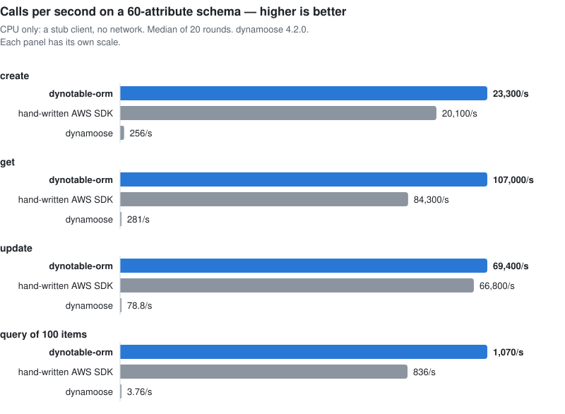

# dynotable-orm

A type-safe, fast DynamoDB ORM for TypeScript, and a successor to dynamoose.

- **dynamoose call shapes.** `get`, `create`, `update`, `query`, `scan`, conditions, transactions and batches
  keep the shapes you know. Your schema gives the types: keys, update paths, condition values, index names.
- **The same stored bytes.** Whole-item writes and top-level updates store the same bytes as dynamoose 4.2.0,
  as an equivalence suite checks on DynamoDB Local. An update of a nested path does not: dynamoose writes it
  as a top-level attribute named by the path. The known differences are in the
  [migration guide](docs/migration-from-dynamoose.md#allowlisted-differences).
- **Any Standard Schema validates.** The Zod 4 adapter adds keys, indexes, Date storage and per-path checks
  on updates. Refinements run on every whole-item write.
- **Fast.** In a CPU benchmark on a stub client (measured 2026-11-06), a create, get or update on a schema
  of about 60 attributes is 93 to 854 times faster than dynamoose 4.2.0, and as fast as hand-written AWS SDK
  code or faster. On a 5-attribute schema, hand-written SDK code is faster on some calls. See
  [benchmarks](docs/benchmarks.md).
- **A codemod** moves dynamoose code over and marks what it cannot move with a TODO.

<picture>
  <source media="(prefers-color-scheme: dark)" srcset="docs/assets/benchmark-order-dark.svg">
  
</picture>

| package                 | what it is                                          |
| ----------------------- | --------------------------------------------------- |
| `dynotable-orm`         | the library                                         |
| `dynotable-orm/zod`     | the Zod 4 adapter: field metadata and `extendZod()` |
| `dynotable-orm-codemod` | migrates dynamoose code and schemas                 |

Pre-release: the API may still change before 1.0.

## Install

```sh
npm install dynotable-orm @aws-sdk/client-dynamodb zod
```

Node 24 or later. `@aws-sdk/client-dynamodb` v3 is a peer dependency. `zod` (v4) is optional.

## 30-second example

```ts
import {DynamoDBClient} from '@aws-sdk/client-dynamodb';
import {model, setClient} from 'dynotable-orm';
import {extendZod} from 'dynotable-orm/zod';
import {z} from 'zod';

extendZod(z); // once, before you build a schema

setClient(new DynamoDBClient({region: 'eu-west-1'}));

export const User = model(
  'User',
  z.object({
    id: z.string().hashKey(),
    email: z.email().index({name: 'byEmail'}),
    plan: z.enum(['free', 'team']).default('free'),
    logins: z.number().default(0),
    createdAt: z.date().optional(),
    updatedAt: z.date().optional()
  }),
  {timestamps: true}
);

await User.create({id: 'u1', email: 'ada@example.com'});

const user = await User.get('u1'); // the item, or undefined

await User.update(
  {id: 'u1'},
  {plan: 'team', $ADD: {logins: 1}},
  {condition: User.condition().where('plan').eq('free')}
);

const found = await User.query('email').eq('ada@example.com').exec();
console.log(user?.plan, found.count);
```

`create` writes only when the key is not stored yet; pass `{overwrite: true}` to replace. `User.update` with
a wrong path or value type does not compile.

## Migrate from dynamoose

The codemod rewrites dynamoose call sites and converts each dynamoose `Schema` to a Zod schema plus model
options. It marks what it cannot convert with a TODO comment.

```sh
npm install dynotable-orm @aws-sdk/client-dynamodb zod
npm install --save-dev dynotable-orm-codemod
npx dynotable-orm-codemod tsconfig.json --dry-run   # lists the files it would change
npx dynotable-orm-codemod tsconfig.json
```

The project must still resolve `dynamoose` when the codemod runs, so remove dynamoose after the last run.
Then fix each TODO, check the [Date storage](docs/migration-from-dynamoose.md#the-date-storage-trap) of
every model that reads an existing table, and run your type check and tests. The
[migration guide](docs/migration-from-dynamoose.md) lists every changed API.

## The Zod adapter

`dynotable-orm/zod` attaches DynamoDB metadata to Zod fields. Use the functions, or call `extendZod(z)` once
to get the same marks as methods. Each mark returns a new schema and never changes the one you pass.

```ts
import {model} from 'dynotable-orm';
import {hashKey, index, rangeKey, storage} from 'dynotable-orm/zod';
import {z} from 'zod';

export const Session = model(
  'Session',
  z.object({
    userId: hashKey(z.string()),
    startedAt: rangeKey(z.number()),
    device: index(z.string(), {name: 'byDevice', rangeKey: 'startedAt'}),
    expiresAt: storage(z.date(), 'seconds')
  })
);
```

You can also give the same settings as model options (`hashKey`, `rangeKey`, `indexes`, `dates`, `combine`).
A setting that a field and an option both give, with different values, throws a `ConfigError` at `model()`.
`getDynamoMeta(schema)` reads a field's metadata, for tools that build on your schemas.

`combine(z.string(), ['a', 'b'], '#')` makes a field the join of other fields, as dynamoose's `COMBINE`
type does. The separator defaults to `,`.

## Model options

| option                | what it does                                                                                             |
| --------------------- | -------------------------------------------------------------------------------------------------------- |
| `hashKey`, `rangeKey` | the key attributes, unless a field marks them                                                            |
| `indexes`             | `{field: {name, type: 'global' \| 'local', rangeKey, project}}`, or an array of them                     |
| `dates`               | `{path: 'iso' \| 'milliseconds' \| 'seconds'}`: the storage of a Date path                               |
| `defaultDateStorage`  | the storage of every other Date, timestamps included. Default `'milliseconds'`, as dynamoose             |
| `combine`             | `{target: {sources, separator}}`                                                                         |
| `timestamps`          | `true`, or `{createdAt: {name, storage}, updatedAt: {name, storage}}`                                    |
| `set`                 | the whole-item hook, see the [migration guide](docs/migration-from-dynamoose.md#the-whole-item-set-hook) |
| `prefix`, `suffix`    | the table name is `${prefix}${name}${suffix}`; overrides `setDefaults()`                                 |
| `client`              | the `DynamoDBClient` of this model; overrides `setClient()`                                              |
| `unknownKeys`         | `'zod'` (default) or `'dynamoose'`, see [unknown keys](docs/migration-from-dynamoose.md#unknown-keys)    |

Without `setClient()` or a `client` option, the first call builds `new DynamoDBClient({})`, which reads
the region and credentials from the environment.

## The API

- `model(name, schema, options)` returns the model: `get`, `create`, `update`, `delete`, `query`, `scan`,
  `batchGet`, `batchPut`, `batchDelete`, `condition()`, `fromStored(raw)`, `withDefaults(item)`,
  `createTableInput()` and `extend(methods)`.
- `M.transaction.create`, `update`, `delete` and `condition` build the entries of `transaction([...])`.
- `setClient`, `getClient`, `setDefaults({prefix, suffix})`, `Condition`, `ifNotExists`,
  `isConditionalCheckFailed`, `orm` (the spy target for `transaction()`), and the errors `ConfigError`,
  `ExpressionError`, `ValidationError` and `MarshallError`.
- Every call takes a per-call `client` and `abortSignal` (queries and scans in `exec({…})`). A client that has the
  request's method (the SDK's aggregated `DynamoDB`) gets that method call, as dynamoose made it.

Dates are stored as epoch milliseconds, as dynamoose stores them, unless you set `defaultDateStorage` or a
field's storage (`'iso'`, `'milliseconds'` or `'seconds'`). A codebase whose items hold ISO strings sets
`defaultDateStorage: 'iso'` on each model: see the
[Date storage trap](docs/migration-from-dynamoose.md#the-date-storage-trap).

## Without Zod

Any [Standard Schema](https://standardschema.dev) validates whole items. Give the keys, indexes and Date
storage as model options. Without the adapter, updates are not checked against the schema (Standard Schema
can only validate a whole value), and keys and condition values are not transformed.

## Docs

The documentation site is [dynotable.com/orm](https://dynotable.com/orm):

- [Getting started](https://dynotable.com/orm/getting-started)
- [The Zod adapter](https://dynotable.com/orm/zod)
- [Migrating from dynamoose](https://dynotable.com/orm/migrate-from-dynamoose)
- [The codemod](https://dynotable.com/orm/codemod)
- [Benchmarks](https://dynotable.com/orm/benchmarks)
- [API reference](https://dynotable.com/orm/api-model)

In this repository: the [migration guide](docs/migration-from-dynamoose.md) and the
[benchmarks](docs/benchmarks.md). The TSDoc in the package types is the API reference too.

## Contributing

See [CONTRIBUTING.md](CONTRIBUTING.md). Report a security issue as [SECURITY.md](SECURITY.md) says, not in a
public issue.

## License

MIT © DynoTable
