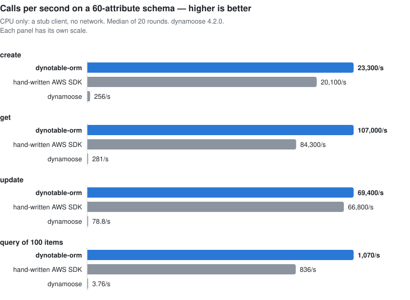

# Benchmarks

These numbers measure the CPU that a call costs inside the process. A stub client returns canned responses,
so they contain no network time. In a real call, DynamoDB's latency is usually larger than any of them.

How to run the benchmark, and the details of each contender and operation, are in
[`packages/dynotable-orm/benchmarks/README.md`](../packages/dynotable-orm/benchmarks/README.md).

## Results

**On a schema of about 60 attributes, dynotable-orm is 93 to 854 times faster than dynamoose 4.2.0 on create,
get and update, and 288 times faster on a query of 100 items. It is also as fast as hand-written AWS SDK
code, or faster. On a 5-attribute schema, hand-written SDK code is faster than dynotable-orm on create,
update and query.**

<picture>
  <source media="(prefers-color-scheme: dark)" srcset="assets/benchmark-order-dark.svg">
  
</picture>

Measured on 2026-11-06 with `pnpm bench --gate`, 20 interleaved rounds. Each panel of the chart has its own
scale. Calls per second is the median over the rounds; 1,000,000 divided by it is the CPU µs per call.
"Times faster" is the median of the per-round ratios, with its 99% confidence interval.

### Large schema (`order`, about 60 attributes)

Calls per second, higher is better:

| Operation         | dynotable-orm | Hand-written SDK | dynamoose 4.2.0 | Times faster than dynamoose |
| ----------------- | ------------: | ---------------: | --------------: | --------------------------: |
| create            |        23,300 |           20,100 |             256 |               93× [85, 112] |
| get               |       107,000 |           84,300 |             281 |             385× [362, 456] |
| update            |        69,400 |           66,800 |            78.8 |           854× [742, 1,090] |
| nested update     |        77,500 |           68,900 |  not comparable |                           - |
| query (100 items) |         1,070 |              836 |            3.76 |             288× [259, 333] |

**Nested update has no dynamoose number.** The call is
`update(key, {$SET: {'notification.status': 'SENT', 'details.refundedAmount': 4250}})`. dynamoose 4.2.0
writes each path as one top-level attribute with that name (`notification.status`), not as a change to the
nested field. It does different work, so the benchmark does not time it.

On the large schema dynotable-orm is faster than hand-written SDK code on create, get and query, and the same
on update (its 99% interval of the CPU ratio is 0.88 to 1.14). The reason: `@aws-sdk/util-dynamodb`'s
`marshall` and `unmarshall` cost more than this library's own conversion.

## The CI gate

The CI workflow runs the gate on every pull request, against the build of its base commit. Only `create`,
`get` and `update` on `order` are gated. A gated row passes when its whole 99% interval meets both targets,
and the lib is not significantly slower than the base:

- lib/raw at most 1.5× (the lib's CPU over hand-written SDK code's);
- dynamoose/lib at least 10× (dynamoose's CPU over the lib's);
- no regression of more than 15% against the base (p < 0.01).

An interval that straddles a target is too noisy to call. The row runs again, and the gate fails when it
still does not pass. A target never passes by default. The run above passed on the first try, with no gated
row more than 3% from the base.

## Other libraries

<picture>
  <source media="(prefers-color-scheme: dark)" srcset="assets/benchmark-small-dark.svg">
  
</picture>

`pnpm bench:competitors` runs all five contenders in one process on the `small` schema (5 flat attributes, one
global index), with 10 interleaved rounds of 200 ms. It is local only, not in CI. Compare numbers only within
this table: they come from one run, and a different run gives different absolute numbers.

Calls per second, higher is better:

| Operation         | dynotable-orm | Hand-written SDK | dynamoose 4.2.0 | ElectroDB 3.9.3 | dynamodb-toolbox 2.11.1 |
| ----------------- | ------------: | ---------------: | --------------: | --------------: | ----------------------: |
| create            |       625,000 |          719,000 |           5,240 |          29,100 |                  87,000 |
| get               |     1,490,000 |        1,070,000 |           3,940 |          46,300 |                 110,000 |
| update            |       671,000 |        1,030,000 |           4,200 |          28,800 |                  66,200 |
| query (100 items) |        35,300 |           37,700 |             159 |           5,780 |                   2,170 |

- dynotable-orm is faster than dynamoose, ElectroDB and dynamodb-toolbox on every row. Against dynamoose, it
  is 119 to 379 times faster (the ratio of the medians).
- **Hand-written SDK code is faster than dynotable-orm on three rows:** create (1.15 times), update (1.53
  times) and query (1.07 times). A one-field update shows the fixed cost of the lib's update path: it checks
  the input and builds the expression, where hand-written code writes one `SET`. dynotable-orm is faster on
  get (1.39 times). None of these rows is gated.
- ElectroDB and dynamodb-toolbox talk to a DocumentClient. Its stub marshalls the input and unmarshalls the
  output, as the real one does, so every contender pays for the conversion. ElectroDB stores its own key
  templates and entity attributes; dynamodb-toolbox runs with its entity attribute and timestamps off.

These are CPU numbers for one small schema. They say nothing about features, about other schemas, or about
network time.

## Method

- **Contenders.** `lib` is this package's built `dist`. `raw` is hand-written SDK code: a Zod `parse` of the
  same input, then `@aws-sdk/util-dynamodb` `marshall` on a write and `unmarshall` on a read. `dynamoose` is
  dynamoose 4.2.0 from npm, pinned in devDependencies, making the same calls. `base` is the build of the base
  commit, for the regression rule.
- **Same work.** Before any timing, a smoke test checks that each contender sends the same literal request
  and returns the same items. Where a library cannot do the same work, it has no number on that row.
- **Schemas.** `order` declares about 60 attributes: nested objects with checks, a list of objects with
  multi-type attributes, schemaless objects, a Set, enums, three global indexes and ISO timestamps. Its
  sample item has 35 top-level attributes and 153 leaf values. `small` has 5 flat attributes and one global
  index.
- **Operations.** `create`, `get`, `update` (top-level fields), `update-nested` (one nested `$SET`, `order`
  only), and `query` returning 100 items.
- **Rounds.** Every contender warms up. Each round then measures each contender for a fixed time, with `gc()`
  before each measurement, and the order of the contenders reverses every round. Inputs are made outside the
  timed part.
